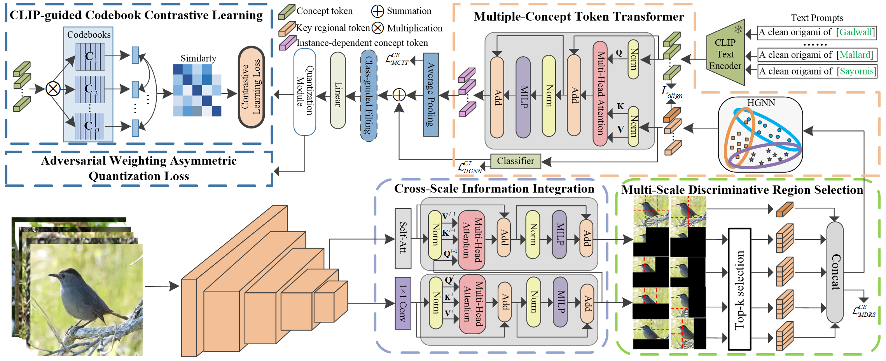
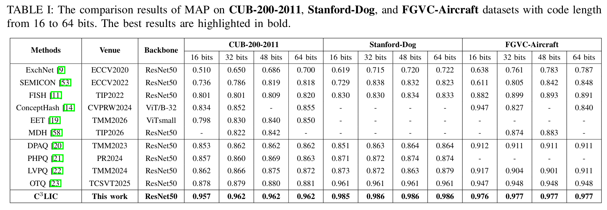
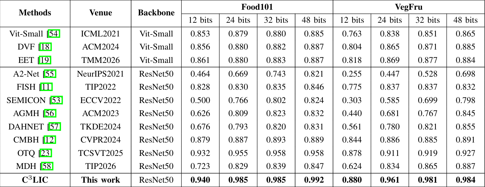

# C3LIC: CLIP-guided Codebook Contrastive Learning with Instance Concepts for Fine-grained Image Retrieval

This project is a pytorch implementation of "C3LIC: CLIP-guided Codebook Contrastive
Learning with Instance Concepts for Fine-grained
Image Retrieval". 

## Paper Link
- C3LIC: CLIP-guided Codebook Contrastive Learning with Instance Concepts for Fine-grained Image Retrieval
- Authors: Lei Ma, Haoxuan Chen, Fanman Meng, Qingbo Wu, Hanyu Hong, and Ying Zhu


## Abstract
Fine-grained image retrieval (FGIR) aims to retrieve images of the same subcategory by capturing subtle differences among visually similar objects that differ only in details. Recently, most fine-grained hashing/quantization methods focus on learning discriminative binary codes from aggregated local and global feature representations. However, they often overlook the influence of non-discriminative region interference and the complementary relationship between high-level human-understandable concepts and low-level visual features, which can hardly capture
subtle visual differences among instances. In addition, existing quantization methods treat the quantization error terms across varying code lengths uniformly, which impairs the discriminative capacity of generated codes and suffers from codebook collapse problem. To address above issues, we propose a CLIP-guided codebook contrastive learning method with instance concepts for fine-grained image retrieval. Specifically, we introduce a cross scale information integration module to implement the cross scale feature registration. Subsequently, we introduce a multiscale discriminative region selection module to select discriminative regional features to reduce the impact of irrelevant and non-discriminative information. Moreover, we build a multiple concept token transformer module to learn instance-dependent concepts by aggregating discriminative visual information from the selected features into the human-understandable concepts. Finally, we propose a progressive adaptive weighting asymmetric quantization loss with a CLIP-guided codebook contrastive learning regularization term to account for the importance of quantization error terms corresponding to different code lengths and encourage the differences within and across different subcodebooks to alleviate the codebook collapse problem. Extensive experimental results on several fine-grained datasets demonstrate our superiority over the state-of-the-art methods. Code and models are available at: https://github.com/noPatience-byte/C3LIC.

## Method


## Requirements
python 3.8

torch 1.13.1

torchvision 0.14.1

## Datasets

| Datasets | Classes | Training images | Test images |  Link |
| :--- | :---: | :---: | :---: | :--- |
| CUB-200-2011 | 200 | 5,994 | 5,794 | https://github.com/noPatience-byte/C3LIC/tree/main/datasets/cub_bird |
| Standford-Dog | 120 | 12,000 | 8,580 | https://github.com/noPatience-byte/C3LIC/tree/main/datasets/stanford_dog |
| FGVC-Aircraft | 100 | 6,667 | 3,333 | https://github.com/noPatience-byte/C3LIC/tree/main/datasets/aircraft |
| Food101 | 101 | 75,750 | 25,250 | https://github.com/noPatience-byte/C3LIC/tree/main/datasets/aircraft |
| VegFru | 292 | 29,200 | 116,931 | https://github.com/noPatience-byte/C3LIC/tree/main/datasets/vegfru |


## Training 

```
train_model.py
```
## CLIP Model Weights
- Vit-B-16: (https://github.com/noPatience-byte/C3LIC/releases/download/CLIP/CLIP.Model.zip)
## Weights
- CUB-200-2011: (https://github.com/noPatience-byte/C3LIC/archive/refs/tags/cub.zip)
- Standford-Dog: (https://github.com/noPatience-byte/C3LIC/releases/download/dog/dog.zip)
- FGVG-Aircraft: (https://github.com/noPatience-byte/C3LIC/releases/download/plane/plane.zip)
## Experimental Results



## Acknowledgements
Many thanks to [FISH (TIP2022)](https://github.com/chenzhenduo/FISH)

